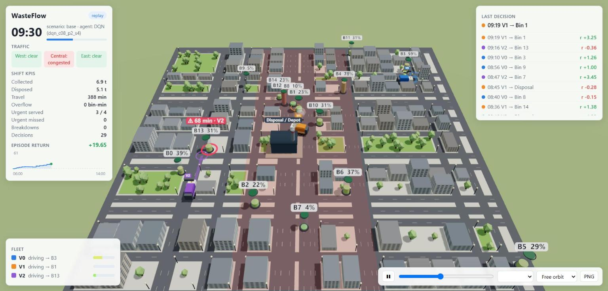

# WasteFlow — Intelligent Waste Operations & Fleet Optimization

Reinforcement-learning dispatch for a simulated waste-collection operation: 15 collection points, 3 trucks, one
disposal facility (also the depot) and an 8-hour shift with filling bins, urgent requests, traffic and
breakdowns. Every time a truck becomes free, the agent decides where it goes next. Four TorchRL agents (DQN,
REINFORCE, A2C, PPO) are trained on the same environment and compared with hand-written dispatch rules and a
route planner.



*The trained DQN agent at 09:30: truck V2 heads to an urgent request at B13 while the central zone is congested.
Left: clock, traffic, live KPIs and the episode return; right: the latest decisions with their rewards.*

- Demo video: _link to be added_
- Report (PDF): _link to be added_

## Quick start

Requires [uv](https://docs.astral.sh/uv/getting-started/installation/), which installs the right Python (3.12)
and every dependency by itself:

```bash
git clone <this repository> && cd dan_nkusi_rl_summative
uv sync
uv run main.py
```

`uv run main.py` (same as `uv run play.py`) plays the best trained agent. Your browser opens the 3D viewer, every
decision is printed in the terminal, and a KPI summary follows at the end of the shift (about a minute at the
default speed, then the viewer stays up for 30 s). No training is needed: the trained models are in `models/`. If
the browser doesn't open, open the URL printed in the terminal.

Run the tests (about 2 minutes):

```bash
uv run pytest
```

## Commands

| Command | What it does |
|---|---|
| `uv run main.py` / `uv run play.py` | Best trained agent (DQN) on a typical test shift, live in the viewer |
| `uv run play.py --algo all` | DQN, REINFORCE, A2C and PPO one after another on the same shift |
| `uv run play.py --algo ppo --scenario high_demand --seed 10003 --speed 20` | Any agent, scenario, seed and speed |
| `uv run play.py --speed 0 --no-browser --hold 0` | Headless: terminal output and KPI table only |
| `uv run main.py replay logs/demo/dqn_episode.json` | Play back a saved episode with a time slider |
| `uv run main.py random-demo` | Random agent in the viewer (the untrained reference) |
| `uv run main.py train dqn --total-frames 100000 --name my_run` | Train one agent (`dqn`, `reinforce`, `a2c`, `ppo`; flags with `--help`) |
| `uv run main.py sweep --list` / `sweep` | The 40 Phase 1 hyperparameter configs / run them in parallel (resumable) |
| `uv run main.py evaluate --scenarios all --policies urgency_first,dqn=models/dqn/<run>/model.pt` | KPI table with 95% CIs on the 50 test seeds |
| `uv run main.py plots` | Rebuild all report figures and tables in `assets/figures/` from `logs/` |

Viewer controls: drag to orbit, scroll to zoom, hover over a bin or truck for details. Cameras: `O` orbit,
`V` overview, `T` top, `S` street, `F` fly-over, `1`-`3` follow truck V0-V2; `H` hides the panels, `Space` plays
or pauses a replay, and the PNG button saves a screenshot. URL options: `?cam=follow0`, `?hud=0`.

## The environment

`environment/custom_env.py`, a Gymnasium environment (`WasteFlow-v0`, env v1.0) on top of an event-driven
simulation.

| | |
|---|---|
| **Decision point** | Whenever a truck becomes free; trucks decide one at a time (event-driven, not fixed time steps) |
| **Actions** | `Discrete(17)`: 0-14 drive to collection point *i* and empty it, 15 drive to the facility and unload, 16 wait 10-15 min. An action mask blocks bins another truck is already heading to, bins too full for the remaining capacity, unloading when empty and waiting when full |
| **Observation** | 111 values in [0, 1] from the deciding truck's point of view: time of shift, demand level, traffic per zone, each bin's fill level, expected fill rate, urgent request and deadline, road distance to each bin, bins already claimed, own load, own distance to the facility, own id. Each feature's meaning, encoding/range, source and update cadence is defined once in `OBS_SPEC` |
| **Reward** | +4 per tonne collected, −0.02 per minute driven, −0.02 per bin-minute in overflow, −2 per missed urgent deadline; at shift end −4 per tonne still on a truck and −2 per truck not back at the depot |
| **Start state** | 06:00, all trucks empty at the depot, bins 10-55% full (random per seed) |
| **Terminal** | Shift end (14:00, 480 simulated minutes); never truncated |
| **Dynamics** | Bins fill at noisy, time-of-day-dependent rates; urgent requests arrive at random (1/h, 45-90 min deadlines); each of 3 traffic zones switches between clear and congested; 2% breakdown chance per trip |

The map is fixed (15 points on a 12 × 12 km area, roads 1.35 × straight-line distance). Three stress scenarios
change one factor each and are used only for testing: `high_demand` (1.5 × demand, 1.8 urgent requests/h),
`high_breakdown` (8% per trip) and `heavy_traffic` (more frequent, longer and heavier congestion).

**Why RL:** every dispatch changes what is possible later (where the truck ends up, how full it is, which bins
overflow meanwhile), and the costs of a decision often arrive hours later, at the end of the shift. That is a
sequential decision problem with delayed rewards, not a one-shot prediction or ranking.

## Experiments

- **Phase 1 sweep:** 10 configs per algorithm (40 runs, 200k frames each), one factor changed at a time: learning
  rate, discount, plus method-specific controls (DQN exploration, replay and target updates; REINFORCE baseline,
  normalization, entropy and episodes per update; A2C and PPO rollout length, entropy, value weight, GAE λ, and
  PPO clipping, epochs and minibatch). Configs were picked on 50 model-selection seeds (30000-30049).
- **Phase 2:** the best config per algorithm × 5 training seeds at 600k frames.
- **Final evaluation:** 50 held-out test seeds (10000-10049), all policies on the same episodes, 95% bootstrap CIs,
  plus the three stress scenarios.

Tables are in `assets/figures/tables/` and figures (learning curves, DQN loss, policy entropy, convergence,
generalization, KPI breakdown, sensitivity) in `assets/figures/` with captions in `captions.md`.

## Results

Mean return on the 50 held-out test seeds; RL rows pool 5 training seeds (95% CI in brackets):

| Policy | base | high_demand | high_breakdown | heavy_traffic |
|---|---|---|---|---|
| Rolling-horizon planner | **59.9** [57.9, 61.7] | **70.6** | **42.3** | **51.9** |
| Urgency-first rule | 57.5 | 67.5 | 42.1 | 48.2 |
| Nearest-job-first rule | 52.1 | 69.5 | 38.7 | 44.2 |
| DQN | 54.1 [52.3, 55.9] | 34.6 | 32.2 | 39.6 |
| PPO | 51.7 [50.4, 53.0] | 29.9 | 35.1 | 39.9 |
| A2C | 48.6 [46.8, 50.3] | 48.6 | 33.8 | 37.6 |
| REINFORCE | 34.2 [32.3, 35.9] | 30.1 | 18.3 | 21.3 |
| Random | 1.0 | −5.9 | −8.6 | −12.3 |

- DQN is the strongest learned agent, but no RL agent beats the planner or the urgency-first rule on `base`.
- The agents collect as much waste as the rules, or more (19.5-20.2 t against 19.2-19.3 t), but lose most of the
  gap at the end of the shift: trucks not back at the depot and waste left on board cost them 6.6-17.7 points
  against about 1.5-3 for the rules.
- Under `high_demand`, which they never trained on, DQN and PPO lose about 20 points while the rules improve.

Full analysis: `logs/eval/final/README.md`.

**Demo agent:** each algorithm's demo agent is its Phase 2 run (of 5) with the highest mean return on the 50
model-selection seeds (`training.best_checkpoint`, scores in `logs/sweep/phase2_selection/`, rebuilt by
`uv run main.py evaluate --policies phase2 --selection --reference "" --out logs/sweep/phase2_selection`). For
DQN that is `models/dqn/dqn_c08_p2_s4`. The default demo seed, 10046, is the test shift where this agent scores
closest to its own 50-shift test average (52.6 against 53.0), so the demo shows a typical shift, not a
hand-picked one.

## Integration API

**Agent.** Load any trained agent and call it on an environment observation:

```python
from environment.custom_env import WasteFlowEnv
from training import Agent, best_checkpoint

agent = Agent.load(best_checkpoint("dqn"))   # or a run folder / model.pt path
env = WasteFlowEnv("base")
obs, _ = env.reset(seed=10046)
agent.reset(10046)                           # seeds sampling for policy-gradient agents
done = False
while not done:
    obs, reward, done, _, info = env.step(agent.act(obs))   # act(obs) -> int in [0, 17), always a valid action
```

**Serialization.** Each run folder (`models/dqn/<run>/`, `models/pg/<algo>_<run>/`) holds `model.pt` (best
validation checkpoint: network `state_dict` plus algo, layer sizes, activation, eval mode, frames and validation
return), `model_final.pt` (last checkpoint) and `config.json` (the full training configuration, loaded into
`Agent.config`).

**State schema.** The three.js frontend reads versioned JSON messages (`schema` + `version`, currently 1.0):
`wasteflow.layout` (map, fleet, shift, and the `policy` driving the episode), `wasteflow.snapshot` (state at each
decision point) and `wasteflow.episode` (a saved episode for replay). They are defined in
`environment/rendering.py`. Live mode streams them over Server-Sent Events from a local server; replay mode
loads a saved episode file.

## Repository layout

```
project_root/
├── pyproject.toml, uv.lock  dependencies (pinned)
├── README.md
├── main.py                  CLI (play, train, sweep, evaluate, plots, random-demo, replay) + baselines, evaluation, sweep
├── play.py                  run the best agent(s) with GUI + verbose terminal output
├── environment/
│   ├── __init__.py
│   ├── custom_env.py        event-driven simulation core, Gymnasium environment, episode rollouts
│   └── rendering.py         JSON state API + three.js viewer server
├── training/
│   ├── __init__.py          shared RL infrastructure (configs, networks, logging, checkpoints, Agent API)
│   ├── dqn_training.py      DQN
│   └── pg_training.py       REINFORCE, A2C, PPO
├── models/dqn, models/pg    trained models (all 60 sweep runs; best checkpoint = model.pt)
├── logs/                    training logs, sweep results, evaluation results, demo episodes
├── assets/                  three.js viewer (three.js bundled, works offline), figures, tables, screenshots
└── tests/                   pytest suite
```
